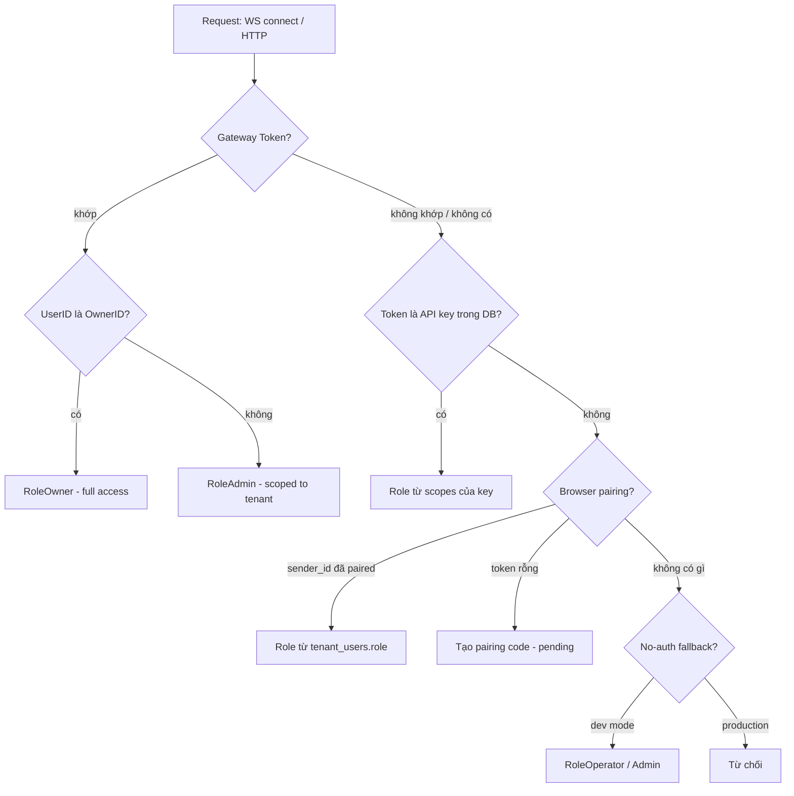
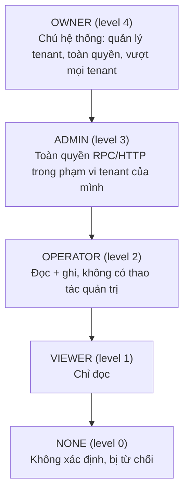
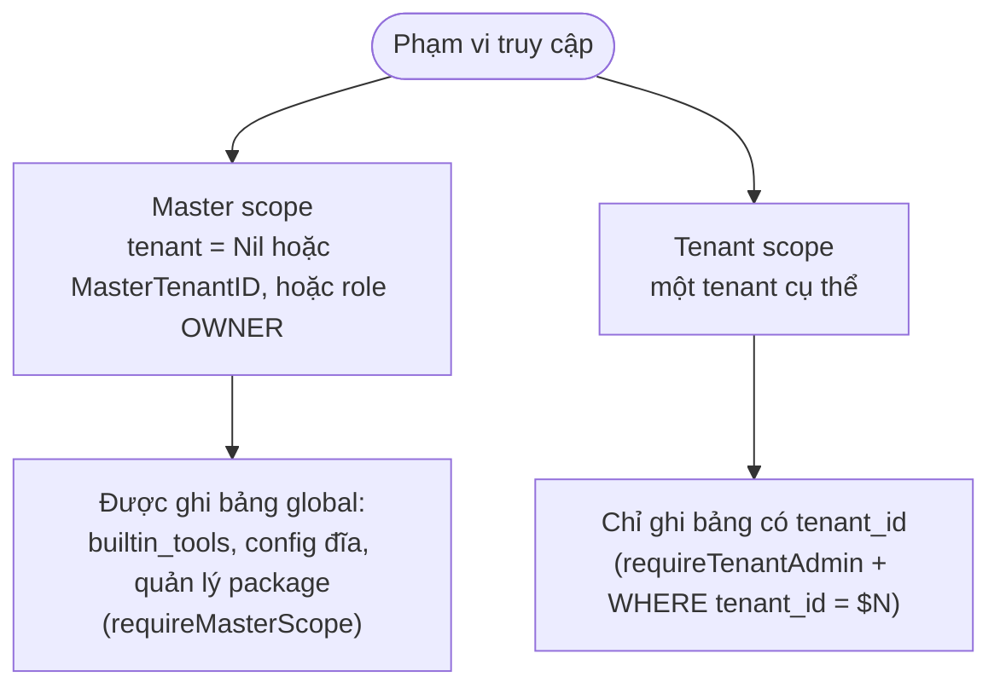

# Kiến trúc xác thực (Authentication Architecture)

Gateway không dùng username/password truyền thống. Đây là API gateway cho AI agents (machine-to-machine + operator), nên xác thực dựa trên **token, API key và pairing**.

Nguồn code: `internal/gateway/router.go` (`handleConnect`), `internal/http/auth.go` (`resolveAuthWithBearer`), `internal/permissions/policy.go`.

## Thứ tự xác thực

## Sơ đồ phân quyền (gia phả)

Nguồn: `internal/permissions/policy.go` (`roleLevel`, `RoleFromTenantRole`, `RoleFromScopes`), `internal/store/tenant_store.go`.

### Cây vai trò (role) — cấp càng cao càng kế thừa quyền của cấp dưới

### Cây người dùng — ai trở thành vai trò nào

```mermaid
flowchart TD
    ROOT(["Hệ thống ManToManAgent"])

    ROOT --> G["Người giữ Gateway Token"]
    ROOT --> K["Người giữ API Key"]
    ROOT --> P["Người dùng Web UI qua Browser Pairing"]
    ROOT --> D["Chế độ dev: không cấu hình token"]

    G --> G1["user_id nằm trong gateway.owner_ids<br/>→ OWNER"]
    G --> G2["user_id khác<br/>→ ADMIN, chỉ trong tenant có membership"]

    K --> K1["scope operator.admin → ADMIN"]
    K --> K2["scope write / approvals / pairing → OPERATOR"]
    K --> K3["scope read, hoặc không scope hợp lệ → VIEWER"]
    K --> K4["scope operator.provision<br/>chỉ mở tenants.create và tenants.users.add,<br/>không thăng vai trò"]

    P --> P1["tenant_users.role = owner → OWNER"]
    P --> P2["tenant_users.role = admin → ADMIN"]
    P --> P3["tenant_users.role = operator hoặc member → OPERATOR"]
    P --> P4["tenant_users.role = viewer, hoặc role lạ → VIEWER"]
    P --> P5["Chưa có membership → OPERATOR (mặc định cũ)"]

    D --> D1["Chỉ khi bind loopback hoặc MANTOMANAGENT_ALLOW_INSECURE_NO_AUTH=1<br/>WS: OPERATOR / HTTP: ADMIN (theo code)"]
```

### Phạm vi tenant (tenant scope)

### Bảng tóm tắt các loại user

| Loại | Cách xác thực | Vai trò gateway | Phạm vi |
|---|---|---|---|
| System owner | Gateway token + `user_id` trong `owner_ids` | `owner` | Mọi tenant (có thể thu hẹp bằng `tenant_id`) |
| Gateway-token user | Gateway token + user khác | `admin` | Tenant có membership |
| API key hệ thống | Bearer API key, `TenantID = Nil` | Theo scope | Master, có thể thu hẹp tenant, không thành owner |
| API key tenant | Bearer API key gắn tenant | Theo scope | Cố định một tenant |
| API key provision | Scope `operator.provision` | Không đổi vai trò | Chỉ tạo tenant và thêm user vào tenant |
| Tenant member (UI) | Browser pairing | Theo `tenant_users.role` | Tenant đã resolve |
| Người dùng channel | Telegram, Feishu, Zalo, Discord, WhatsApp | Không dùng role gateway; bị giới hạn bởi tool policy các lớp 2-5 | Theo agent và channel |

Vai trò tenant `member` không phải vai trò gateway; nó được ánh xạ sang `operator`. Phương thức RPC chưa được phân loại (`RoleNone`) bị từ chối với mọi vai trò, kể cả owner (fail-closed).

## Các cơ chế

### 1. Gateway token
- Secret tĩnh cho cả deployment, cấu hình qua `config.json` / env (`.env.local`), không lưu trong config file.
- So sánh bằng `subtle.ConstantTimeCompare` (chống timing attack).
- `UserID` nằm trong `gateway.owner_ids` → `RoleOwner` (có thể thu hẹp tenant qua `tenant_id`). Ngược lại → `RoleAdmin`, chỉ trong tenant mà user có membership.
- HTTP: `Authorization: Bearer <token>`, header `X-ManToManAgent-Tenant-Id` để chọn tenant.
- Nếu `owner_ids` rỗng, chỉ `system` được coi là owner (fail-closed).

### 2. API key
- Tạo/thu hồi qua `api_keys.*` (WS) hoặc HTTP `/v1/api-keys`.
- Chỉ lưu hash (`crypto.HashAPIKey`); cache 5 phút, invalidate qua message bus.
- Role suy ra từ scopes (`admin`, `read`, `write`, `approvals`, `pairing`).
- Key gắn `OwnerID` → ép `userID = OwnerID`. Key gắn `TenantID` → cố định tenant; key hệ thống (`TenantID == Nil`) không bao giờ thành owner.

### 3. Browser pairing
Dành cho Web UI không có token:
1. Client `connect` không token → server sinh pairing code, trạng thái `pending_pairing`; client chỉ gọi được `browser.pairing.status`.
2. Admin duyệt qua `pairing.approve`.
3. Client reconnect với `sender_id` → `IsPaired(senderID, "browser")` → xác thực.
4. Role lấy từ `tenant_users.role` của tenant đã resolve; mặc định `RoleOperator` nếu chưa có membership. Lỗi DB → từ chối (fail-closed).
- HTTP dùng header `X-ManToManAgent-Sender-Id`.

### 4. No-auth fallback
Chỉ khi không cấu hình gateway token **và** bind vào loopback (`127.0.0.1`, `localhost`, `::1`) hoặc đặt `MANTOMANAGENT_ALLOW_INSECURE_NO_AUTH=1` (theo `docs/20-api-keys-auth.md`). Nếu token rỗng mà bind `0.0.0.0` hoặc địa chỉ không phải loopback, gateway không khởi động. Không dùng trên host dùng chung, Docker expose port, hay production.

## Vì sao không dùng tài khoản + mật khẩu

| Lý do | Giải thích |
|---|---|
| Đối tượng gọi là máy/agent | Tích hợp, automation, CLI dùng API key scoped, xoay vòng được; không cần session/cookie. |
| Người dùng cuối đi qua channel | Telegram, Feishu, Zalo, Discord, WhatsApp đã có danh tính riêng (sender ID); gateway không cần form đăng nhập. |
| Multi-tenant | Quyền gắn với `tenant_users.role` theo từng tenant, không phải tài khoản toàn cục. |
| Giảm bề mặt tấn công | Không lưu mật khẩu, không có reset/brute-force/credential stuffing; key chỉ lưu hash. |
| UX cho Web UI | Pairing code do admin duyệt thay cho đăng ký/đăng nhập; phù hợp self-hosted và desktop (Lite). |
| Vận hành đơn giản | Self-hosted: một gateway token do operator nắm giữ là đủ để bootstrap. |

## Phân quyền

- Role: `owner` > `admin` > `operator` > `viewer` (`internal/permissions`).
- Ghi vào bảng global (không có `tenant_id`) phải qua `requireMasterScope`; bảng theo tenant qua `requireTenantAdmin` + `WHERE tenant_id = $N`.
- Log bảo mật: `slog.Warn("security.*")`.

## Quyền theo method RPC

Nguồn: `docs/19-websocket-rpc.md` §20 (Permission Matrix). Chưa đối chiếu từng method với `isAdminMethod`/`isWriteMethod` trong `policy.go`.

| Vai trò tối thiểu | Method |
|---|---|
| Admin | `config.apply`, `config.patch`, `agents.create/update/delete`, `channels.toggle`, `device.pair.approve/deny/revoke/update`, `teams.create/delete/update/members.*`, `teams.task.delete*`, `api_keys.*` (cả `list`), `tenants.create/update/users.add/users.remove` |
| Operator | `chat.send/abort/inject`, `sessions.delete/reset/patch`, `cron.*`, `skills.update`, `exec.approval.*`, `send`, `teams.tasks.*` |
| Viewer | Mọi method đã phân loại là đọc: list, get, preview, status, history, `tenants.list/get/users.list/mine`, `teams.list` |
| Công khai (trước khi xác thực) | `connect`, `health`, `browser.pairing.status` (chỉ client đang chờ duyệt), `device.pair.request` |

Lưu ý: không có method nào đòi `owner` riêng; `tenants.*` ghi chỉ cần `admin` ở tầng method (đối chiếu `policy.go:300-304`). Chặn thêm theo phạm vi tenant (master scope, `requireMasterScope`) nằm ở handler, không ở bảng này. `teams.tasks.*` mặc định là Operator trong tài liệu 19, nhưng `teams.task.delete*` là Admin trong code. Method chưa phân loại (`RoleNone`) bị từ chối với mọi vai trò kể cả owner. Scope `operator.provision` mở riêng `tenants.create` và `tenants.users.add` mà không cần role admin (`IsProvisionMethod`).

## Lưu ý và hạn chế

- Gateway token là secret toàn cục: lộ token = quyền admin; cần xoay vòng thủ công.
- Pairing `sender_id` hoạt động như bearer credential phía client; bảo vệ bằng TLS và thu hồi qua `pairing.revoke`.
- Muốn thêm đăng nhập user/password: thêm path mới trong `handleConnect` (sau API key) và `resolveAuthWithBearer`, kèm bảng credential, rate limit, và đủ 3 i18n catalog.
