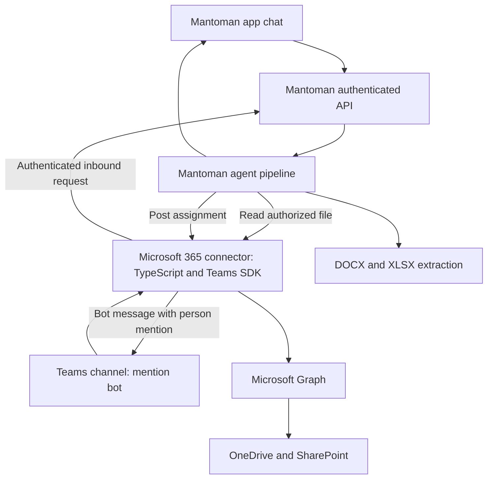

# Mantoman Agent: Microsoft Teams and Microsoft 365 Integration

Date: 2026-11-22
Status: Historical proposal; superseded in part by the in-progress [`teams-bot`](../teams-bot/README.md) service. Do not deploy it before its real-tenant acceptance gates pass.

The current implementation targets shared project libraries through application `Sites.Selected` and explicit site grants, not delegated personal OneDrive. It reuses existing chat/MCP settings without new file or person pickers, and allows preauthorized posting within configured policy. The remaining proposal below describes alternatives, not implemented behavior.

## Goal

Support two workflows through the same Mantoman agent pipeline:

1. In the Mantoman app, select a Microsoft 365 requirements file, a responsible person, and a Teams channel. The agent reads the file and posts an assignment mentioning that person.
2. In Teams, mention the Mantoman bot with a requirements file/link and a responsible person. The bot forwards the request to Mantoman, which reads the file and sends the resulting assignment back to Teams.

**An assignment is a channel message mentioning the responsible person. This design does not create Microsoft Planner tasks.**

## Architecture

Two entry points, one agent pipeline, one Microsoft 365 connector.



Keep the existing Go gateway and agent pipeline. Add a small TypeScript connector using Microsoft's current Teams SDK. The connector handles Microsoft authentication, file access, and Teams delivery; it does not run a second AI orchestration layer.

Tradeoff: an additional Node.js service, but less custom Microsoft authentication and messaging protocol code than a native Go implementation. Microsoft's current Teams SDK supports TypeScript, C#, and Python, not Go.

## Workflow 1: Start in the Mantoman App

Example:

> Read [Requirements.xlsx], assign implementation to [@Alice], and post it in [#Project Phoenix].

### 1. Select Microsoft resources

Use file, person, and channel pickers/search. Render selections as chips carrying stable references rather than ambiguous display names.

- File: drive ID, item ID, and version/ETag where available.
- Person: Microsoft Entra object ID.
- Destination: team ID and channel ID.

### 2. Submit an authenticated request

Mantoman authenticates the requester, resolves their linked Microsoft identity, and validates resource access server-side.

### 3. Read and extract requirements

The connector downloads the authorized file through Microsoft Graph.

- DOCX: extract headings, paragraphs, and tables.
- XLSX: extract sheet names, cells, and stored formula results. Do not execute macros. Flag missing or potentially stale calculated values instead of inventing results.
- Preserve source locations, such as `Scope!B12`, so the assignment can cite its evidence.
- Bound file size and extracted content; explicitly report unsupported or encrypted documents.

### 4. Generate the assignment

The agent produces:

- Title and summary.
- Requirements and acceptance criteria.
- Responsible person.
- Source links and locations.
- Explicit ambiguities or missing information.

Do not invent deadlines or silently resolve unclear requirements.

### 5. Deliver to Teams

The connector sends a bot-authored message containing a real Teams mention of the assignee. Return the posted message reference/link to Mantoman.

Prerequisites:

- The bot is installed and permitted in the destination team.
- Its conversation routing information is persisted for proactive posting.

Report success only after Teams accepts the message.

## Workflow 2: Start in Teams

Example:

> @Mantoman read this requirements file and assign implementation to @Alice.

1. Teams delivers the mention to the connector.
2. The connector validates Microsoft authentication and extracts the requester, Microsoft tenant, team/channel/conversation/thread, mentioned people, and attached files or supported Microsoft file links.
3. The connector forwards an authenticated request to Mantoman.
4. Mantoman maps the Microsoft tenant and requester to its own tenant and user. Do not trust caller-supplied internal tenant IDs.
5. The same file-reading, extraction, and assignment-generation pipeline runs.
6. The connector posts the assignment into the originating thread, mentioning the assignee.

A Teams mention does not automatically authorize access to the requester's OneDrive. If delegated access is missing, provide a private **Connect Microsoft 365** sign-in action and resume the request after authorization. Never publish sign-in secrets in the channel.

## Component Responsibilities

These boundaries and operations are proposals, not existing API contracts.

| Component | Responsibility |
|---|---|
| Mantoman app | File/person/channel selection, Microsoft connection, chat results |
| Mantoman gateway | User/tenant authorization, agent execution, operation state |
| Microsoft connector | Teams SDK events, OAuth, Graph calls, Teams posting |
| Document extractor | Convert DOCX/XLSX into bounded, source-labelled content |
| Persistence | Identity links, encrypted tokens, conversation references, delivery records |

Expose a small authenticated internal connector interface for:

- Searching/resolving authorized files, people, and destinations.
- Reading selected files.
- Posting assignments.
- Forwarding Teams requests into Mantoman.

Do not expose a general-purpose Graph HTTP proxy to the model. Exact endpoints and permission requirements must be verified during implementation.

## Authentication and Permissions

Use separate authorization contexts for user data access and bot messaging.

| Action | Recommended identity/access |
|---|---|
| Read requester's files | Delegated Graph token for the linked user |
| Read designated project files unattended | Application permissions restricted to explicitly selected resources |
| Receive direct bot mentions | Bot installation and normal Teams activity delivery |
| Read additional channel/chat messages | Resource-specific consent (RSC) for the installed team/chat |
| Post assignment messages | Bot identity through Teams SDK |

### Microsoft setup

- A Microsoft 365 tenant with Teams.
- Permission to register the app identity and install the custom Teams application; tenant administrator approval may be required.
- A Teams app package with manifest and icons.
- A publicly reachable HTTPS messaging endpoint; use a development tunnel locally.
- Appropriate bot registration, credentials, and installation scopes.
- An Entra OAuth configuration for delegated Graph access.

### File access

Start with delegated access for the requesting user:

- `Files.Read` for the signed-in user's files.
- `Files.Read.All` only when the broader set of files the user can access is required.
- `offline_access` if background access requires refresh tokens.

A Teams SSO token is not automatically a Graph access token. Use the appropriate OAuth flow, including an on-behalf-of exchange where applicable.

For unattended project-file access, consider selected application permissions such as `Sites.Selected` or `Files.SelectedOperations.Selected`, with explicit read grants on the required resources. Consent alone is insufficient: selected permissions also require resource-level grants.

Teams channel documents generally reside in SharePoint; chat-shared files commonly reside in OneDrive. Support both storage locations.

### Teams message access

The requested workflow only requires bot mentions and explicit file references. Do not request access to every Teams message by default.

If additional conversation context is needed, declare the applicable RSC permissions in the Teams app manifest:

```json
{
  "authorization": {
    "permissions": {
      "resourceSpecific": [
        {
          "name": "ChannelMessage.Read.Group",
          "type": "Application"
        },
        {
          "name": "ChatMessage.Read.Chat",
          "type": "Application"
        }
      ]
    }
  }
}
```

Install or upgrade the app and obtain the required consent, subject to tenant policy. These permissions apply to the authorized team/chat, not every conversation in the organization. Historical messages require Graph retrieval; they are not automatically replayed to the bot.

Use Teams SDK for bot-authored messaging. Do not treat Graph migration permissions as a general-purpose application-only message-sending mechanism.

## Normalized Request

Both entry points should resolve into the same internal request containing:

- Mantoman tenant and user, resolved by the server.
- Linked Microsoft tenant and user.
- Origin: app chat or Teams.
- Prompt.
- File references: drive ID, item ID, version/ETag where available.
- Assignee: Entra object ID.
- Destination: team/channel and optional reply thread, plus bot conversation routing reference.
- Correlation and idempotency IDs.

Resolve authorization server-side. IDs supplied by the user or model are resource references, not proof of permission.

## Delivery State and Duplicate Prevention

Persist execution and delivery state separately from generated text:

```text
received -> reading -> generating -> posting -> posted
                                            -> failed
```

Any stage can fail; retain enough state to explain the failure and safely resume where appropriate.

- Deduplicate redelivered Teams activities.
- Record the target, operation ID, and returned Teams message reference.
- A failed post must not appear as a completed assignment.
- A timeout can leave delivery uncertain. Reconcile that outcome instead of blindly reposting and claiming exactly-once delivery.

## Security and Data Boundaries

1. **Read permission is not disclosure permission.** A private document readable by the requester must not automatically be summarized into a channel. Apply an explicit destination-sharing policy or request approval at that boundary.
2. Keep extracted content, cached messages, and memory scoped by tenant, user, and resource authorization.
3. Do not put a user's private Microsoft content into shared agent memory.
4. Treat document contents as untrusted data, never as instructions that override agent policy.
5. Validate Microsoft file references and links; do not fetch arbitrary URLs through the connector.
6. Encrypt tokens and credentials. Never send tokens or temporary download URLs to the LLM.
7. Resolve real Microsoft identities for mentions; do not infer assignees from display names.
8. Restrict connector-to-gateway traffic with service authentication and tenant-aware authorization.
9. Recheck permissions on access and define cache expiry/revocation behavior; a prior successful download is not a permanent access grant.

## Product Surface Scope

Target the standard gateway and web app.

| Surface | Required integration |
|---|---|
| Gateway | Connector transport, inbound/outbound routing, tenant mapping, agent tools, health |
| API contract | Structured Microsoft references, operation status, authenticated connector requests |
| Web UI | Microsoft connection, file/person/channel pickers, status and errors, translations |
| CLI/runtime package | Connector deployment/configuration and channel status support where applicable |
| Storage | Identity/token mappings, conversation references, delivery records; migrations as needed |
| Desktop Lite | Currently disables channels; requires an explicit edition-policy change before claiming support |

Existing repository extension points identified during investigation:

- `internal/channels/channel.go`: shared channel interface.
- `internal/channels/instance_loader.go`: channel factory registration.
- `cmd/gateway_channels_setup.go`: configuration-based channel setup.

A native `msteams` channel is now implemented in `internal/channels/msteams` via the Bot Connector REST protocol. See the gateway and channel package for current capabilities. The remaining proposal text below applies to the TypeScript connector integration, which is a separate effort.

## Acceptance Scenarios

- App chat can select an authorized DOCX/XLSX, person, and destination.
- Teams bot mention can reference the same resources and invoke the same pipeline.
- Both flows generate source-grounded requirements and real assignee mentions.
- Replies go to the intended channel/thread.
- Missing authorization triggers private sign-in instead of a misleading file-read failure.
- Unauthorized users/tenants/resources are rejected.
- Private file content cannot leak into another user's session or an unauthorized destination.
- Redelivered activities do not trigger duplicate executions.
- Successful delivery returns a verifiable Teams message reference/link.
- Failed or uncertain delivery is not reported as success.
- Restart preserves required identity links, operation state, and bot conversation routing.

## References

Microsoft documentation consulted on 2026-11-22:

- [Teams SDK overview](https://learn.microsoft.com/en-us/microsoftteams/platform/teams-sdk-overview)
- [Teams developer CLI](https://learn.microsoft.com/en-us/microsoftteams/platform/teams-developer-cli-overview)
- [Deprecated Teams tools and SDKs](https://learn.microsoft.com/en-us/microsoftteams/platform/deprecated-tools-sdks)
- [Receive all messages and configure Teams RSC](https://learn.microsoft.com/en-us/microsoftteams/platform/agents-in-teams/enable-receive-all-chat-messages)
- [Selected permissions for OneDrive and SharePoint](https://learn.microsoft.com/en-us/graph/permissions-selected-overview)
- [Graph message-send API and permission restrictions](https://learn.microsoft.com/en-us/graph/api/chatmessage-post?view=graph-rest-1.0)

## Next Step

Implement the connector and shared authenticated request flow, then prove both entry points against a real Microsoft 365 test tenant. Verify exact API contracts, resource-specific permissions, deployment topology, and all affected product surfaces before treating this architecture as an implementation plan.
