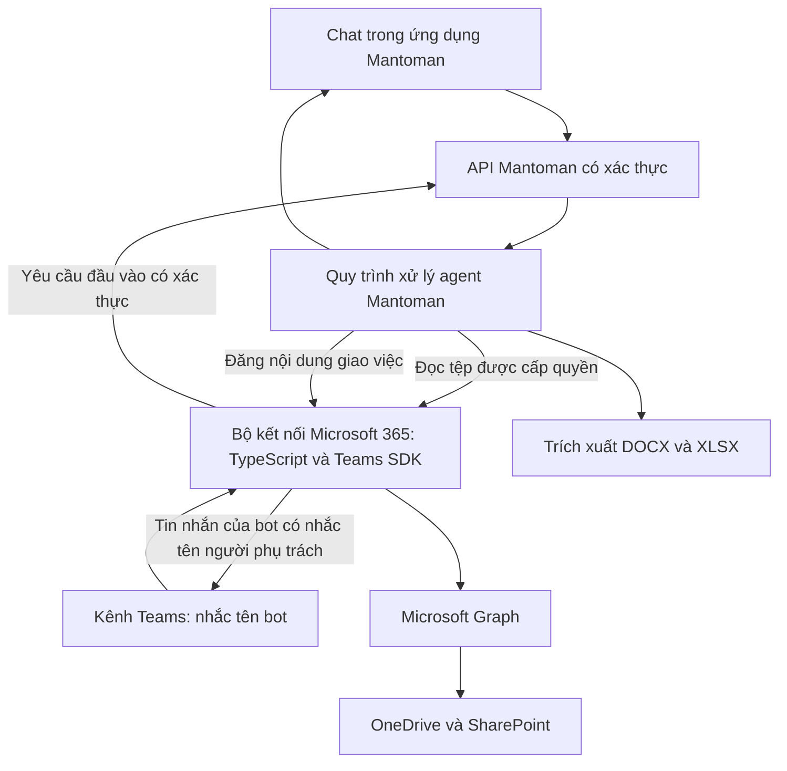

# Mantoman Agent: Tích hợp Microsoft Teams và Microsoft 365

Ngày: 2026-11-22
Trạng thái: Đề xuất lịch sử; một phần đã được thay thế bởi dịch vụ [`teams-bot`](../teams-bot/README.md) đang triển khai. Không triển khai vận hành trước khi hoàn tất kiểm thử trên tenant thực.

Phạm vi hiện tại dùng thư viện dự án chia sẻ với quyền ứng dụng `Sites.Selected` và cấp quyền đọc cho từng site; không dùng OneDrive cá nhân theo quyền ủy quyền. Dịch vụ dùng lại chat/MCP hiện có, không thêm bộ chọn tệp hoặc người, và cho phép đăng trực tiếp trong phạm vi cấu hình. Nội dung đề xuất bên dưới không phải mô tả hành vi đã hoàn thiện.

## Mục tiêu

Hỗ trợ hai luồng sử dụng chung quy trình xử lý agent của Mantoman:

1. Trong ứng dụng Mantoman, chọn tệp yêu cầu trên Microsoft 365, người phụ trách và kênh Teams. Agent đọc tệp rồi đăng tin nhắn giao việc có nhắc tên người đó.
2. Trong Teams, nhắc tên bot Mantoman kèm tệp/liên kết yêu cầu và người phụ trách. Bot chuyển yêu cầu đến Mantoman; Mantoman đọc tệp và gửi nội dung giao việc trở lại Teams.

**Giao việc ở đây là đăng tin nhắn trong kênh và nhắc tên người phụ trách. Thiết kế này không tạo tác vụ trong Microsoft Planner.**

## Kiến trúc

Hai điểm tiếp nhận, một quy trình xử lý agent, một bộ kết nối Microsoft 365.



Giữ nguyên gateway Go và quy trình xử lý agent hiện có. Bổ sung một bộ kết nối nhỏ viết bằng TypeScript, sử dụng Teams SDK hiện hành của Microsoft. Bộ kết nối xử lý xác thực Microsoft, truy cập tệp và gửi tin nhắn Teams; không chạy thêm một tầng điều phối AI thứ hai.

Đánh đổi: cần thêm một dịch vụ Node.js, nhưng giảm lượng mã tự viết cho xác thực Microsoft và giao thức nhắn tin so với triển khai thuần Go. Teams SDK hiện hỗ trợ TypeScript, C# và Python, không hỗ trợ Go.

## Luồng 1: Bắt đầu từ ứng dụng Mantoman

Ví dụ:

> Đọc [Requirements.xlsx], giao việc triển khai cho [@Alice] và đăng vào [#Project Phoenix].

### 1. Chọn tài nguyên Microsoft

Cung cấp bộ chọn/tìm kiếm tệp, người và kênh. Hiển thị lựa chọn dưới dạng thẻ chứa tham chiếu ổn định, thay vì chỉ dùng tên hiển thị dễ gây nhầm lẫn.

- Tệp: drive ID, item ID và phiên bản/ETag nếu có.
- Người: object ID trong Microsoft Entra.
- Đích gửi: team ID và channel ID.

### 2. Gửi yêu cầu có xác thực

Mantoman xác thực người gửi, xác định danh tính Microsoft đã liên kết và kiểm tra quyền truy cập tài nguyên ở phía máy chủ.

### 3. Đọc và trích xuất yêu cầu

Bộ kết nối tải tệp được cấp quyền thông qua Microsoft Graph.

- DOCX: trích xuất tiêu đề, đoạn văn và bảng.
- XLSX: trích xuất tên trang tính, ô và kết quả công thức đã lưu. Không chạy macro. Đánh dấu giá trị tính toán bị thiếu hoặc có thể đã cũ, thay vì tự suy ra kết quả.
- Giữ vị trí nguồn, chẳng hạn `Scope!B12`, để nội dung giao việc có thể dẫn chứng.
- Giới hạn kích thước tệp và lượng nội dung trích xuất; báo rõ tài liệu không được hỗ trợ hoặc bị mã hóa.

### 4. Tạo nội dung giao việc

Agent tạo:

- Tiêu đề và tóm tắt.
- Yêu cầu và tiêu chí nghiệm thu.
- Người phụ trách.
- Liên kết và vị trí nguồn.
- Những điểm chưa rõ hoặc thông tin còn thiếu.

Không tự đặt thời hạn hoặc âm thầm diễn giải yêu cầu chưa rõ.

### 5. Gửi đến Teams

Bộ kết nối gửi tin nhắn dưới danh tính bot, chứa lượt nhắc tên thực sự của người được giao việc trong Teams. Trả tham chiếu/liên kết tin nhắn đã đăng về Mantoman.

Điều kiện tiên quyết:

- Bot đã được cài đặt và được phép hoạt động trong team đích.
- Thông tin định tuyến hội thoại của bot được lưu bền vững để chủ động gửi tin nhắn.

Chỉ báo thành công sau khi Teams chấp nhận tin nhắn.

## Luồng 2: Bắt đầu từ Teams

Ví dụ:

> @Mantoman đọc tệp yêu cầu này và giao việc triển khai cho @Alice.

1. Teams chuyển sự kiện nhắc tên đến bộ kết nối.
2. Bộ kết nối kiểm tra xác thực Microsoft và trích xuất người gửi, tenant Microsoft, team/kênh/hội thoại/luồng thảo luận, những người được nhắc tên, cùng tệp đính kèm hoặc liên kết tệp Microsoft được hỗ trợ.
3. Bộ kết nối chuyển yêu cầu có xác thực đến Mantoman.
4. Mantoman ánh xạ tenant Microsoft và người gửi sang tenant và người dùng nội bộ. Không tin tưởng tenant ID nội bộ do bên gọi tự cung cấp.
5. Chạy cùng quy trình đọc tệp, trích xuất và tạo nội dung giao việc.
6. Bộ kết nối đăng nội dung giao việc vào luồng thảo luận gốc và nhắc tên người phụ trách.

Việc nhắc tên bot trong Teams không tự động cấp quyền truy cập OneDrive của người gửi. Nếu thiếu quyền ủy quyền của người dùng, cung cấp thao tác đăng nhập **Kết nối Microsoft 365** qua kênh riêng tư, rồi tiếp tục xử lý sau khi được cấp quyền. Không đăng thông tin bí mật phục vụ đăng nhập vào kênh.

## Trách nhiệm của các thành phần

Các ranh giới và thao tác dưới đây là đề xuất, không phải hợp đồng API hiện có.

| Thành phần | Trách nhiệm |
|---|---|
| Ứng dụng Mantoman | Chọn tệp/người/kênh, kết nối Microsoft, hiển thị kết quả chat |
| Gateway Mantoman | Phân quyền người dùng/tenant, thực thi agent, trạng thái xử lý |
| Bộ kết nối Microsoft | Sự kiện Teams SDK, OAuth, gọi Graph, đăng tin Teams |
| Bộ trích xuất tài liệu | Chuyển DOCX/XLSX thành nội dung có giới hạn và nhãn nguồn |
| Lưu trữ bền vững | Liên kết danh tính, token được mã hóa, tham chiếu hội thoại, bản ghi gửi tin |

Cung cấp giao diện nội bộ nhỏ, có xác thực cho bộ kết nối để:

- Tìm kiếm/xác định tệp, người và đích gửi được cấp quyền.
- Đọc tệp đã chọn.
- Đăng nội dung giao việc.
- Chuyển yêu cầu từ Teams vào Mantoman.

Không cung cấp cho mô hình một HTTP proxy Graph đa năng. Endpoint và quyền cụ thể phải được xác minh khi triển khai.

## Xác thực và phân quyền

Tách biệt ngữ cảnh cấp quyền truy cập dữ liệu người dùng với ngữ cảnh gửi tin của bot.

| Thao tác | Danh tính/quyền truy cập đề xuất |
|---|---|
| Đọc tệp của người gửi | Token Graph theo quyền ủy quyền của người dùng đã liên kết |
| Tự động đọc tệp dự án được chỉ định, không cần người dùng đăng nhập | Quyền ứng dụng giới hạn vào tài nguyên được chọn rõ ràng |
| Nhận lượt nhắc tên trực tiếp của bot | Cài đặt bot và cơ chế chuyển sự kiện Teams thông thường |
| Đọc thêm tin nhắn trong kênh/chat | Chấp thuận theo tài nguyên cụ thể (RSC) cho team/chat đã cài ứng dụng |
| Đăng tin nhắn giao việc | Danh tính bot thông qua Teams SDK |

### Thiết lập phía Microsoft

- Tenant Microsoft 365 có Teams.
- Quyền đăng ký danh tính ứng dụng và cài ứng dụng Teams tùy chỉnh; có thể cần quản trị viên tenant phê duyệt.
- Gói ứng dụng Teams gồm manifest và biểu tượng.
- Endpoint HTTPS nhận tin nhắn có thể truy cập công khai; dùng đường hầm phát triển khi chạy cục bộ.
- Đăng ký bot, thông tin xác thực và phạm vi cài đặt phù hợp.
- Cấu hình OAuth trong Entra để truy cập Graph theo quyền ủy quyền của người dùng.

### Truy cập tệp

Bắt đầu với quyền ủy quyền của người gửi:

- `Files.Read` để đọc tệp của người dùng đã đăng nhập.
- Chỉ dùng `Files.Read.All` khi cần phạm vi rộng hơn, gồm các tệp mà người dùng có quyền truy cập.
- `offline_access` nếu truy cập nền cần refresh token.

Token SSO của Teams không tự động là access token của Graph. Dùng luồng OAuth phù hợp, bao gồm trao đổi token on-behalf-of khi áp dụng.

Để tự động truy cập tệp dự án mà không cần người dùng đăng nhập, cân nhắc quyền ứng dụng có chọn lọc như `Sites.Selected` hoặc `Files.SelectedOperations.Selected`, kèm cấp quyền đọc rõ ràng trên tài nguyên cần thiết. Chỉ chấp thuận quyền ứng dụng là chưa đủ: nhóm quyền có chọn lọc còn yêu cầu cấp quyền ở cấp tài nguyên.

Tài liệu trong kênh Teams thường nằm trên SharePoint; tệp chia sẻ trong chat thường nằm trên OneDrive. Cần hỗ trợ cả hai nơi lưu trữ.

### Truy cập tin nhắn Teams

Luồng được yêu cầu chỉ cần lượt nhắc tên bot và tham chiếu tệp rõ ràng. Không mặc định xin quyền đọc mọi tin nhắn Teams.

Nếu cần thêm ngữ cảnh hội thoại, khai báo quyền RSC tương ứng trong manifest ứng dụng Teams:

```json
{
  "authorization": {
    "permissions": {
      "resourceSpecific": [
        {
          "name": "ChannelMessage.Read.Group",
          "type": "Application"
        },
        {
          "name": "ChatMessage.Read.Chat",
          "type": "Application"
        }
      ]
    }
  }
}
```

Cài đặt hoặc nâng cấp ứng dụng và lấy sự chấp thuận cần thiết theo chính sách tenant. Các quyền này áp dụng cho team/chat được cấp quyền, không phải mọi hội thoại trong tổ chức. Tin nhắn lịch sử phải được truy xuất qua Graph; chúng không tự động được phát lại cho bot.

Dùng Teams SDK để gửi tin dưới danh tính bot. Không sử dụng quyền di chuyển dữ liệu của Graph như một cơ chế gửi tin đa năng chỉ bằng danh tính ứng dụng.

## Yêu cầu đầu vào chuẩn hóa

Cả hai điểm tiếp nhận nên được chuẩn hóa thành cùng một yêu cầu nội bộ gồm:

- Tenant và người dùng Mantoman do máy chủ xác định.
- Tenant và người dùng Microsoft đã liên kết.
- Nguồn: chat trong ứng dụng hoặc Teams.
- Nội dung yêu cầu.
- Tham chiếu tệp: drive ID, item ID, phiên bản/ETag nếu có.
- Người phụ trách: Entra object ID.
- Đích gửi: team/kênh và luồng trả lời nếu có, kèm tham chiếu định tuyến hội thoại của bot.
- ID liên kết truy vết và ID chống xử lý trùng (idempotency).

Kiểm tra phân quyền ở phía máy chủ. ID do người dùng hoặc mô hình cung cấp chỉ là tham chiếu tài nguyên, không phải bằng chứng có quyền truy cập.

## Trạng thái gửi và chống trùng lặp

Lưu trạng thái thực thi và gửi tin riêng biệt với văn bản do agent tạo:

```text
received -> reading -> generating -> posting -> posted
                                            -> failed
```

Ý nghĩa: đã nhận → đang đọc → đang tạo nội dung → đang đăng → đã đăng; `failed` là thất bại.

Bất kỳ bước nào cũng có thể thất bại; lưu đủ trạng thái để giải thích lỗi và tiếp tục an toàn khi phù hợp.

- Loại bỏ sự kiện Teams bị chuyển lại trùng lặp.
- Ghi lại đích gửi, ID thao tác và tham chiếu tin nhắn Teams trả về.
- Không hiển thị việc giao nhiệm vụ là hoàn tất nếu đăng tin thất bại.
- Hết thời gian chờ có thể khiến kết quả gửi chưa xác định. Đối soát kết quả thay vì đăng lại một cách mù quáng và tuyên bố bảo đảm gửi đúng một lần.

## Bảo mật và ranh giới dữ liệu

1. **Quyền đọc không đồng nghĩa với quyền tiết lộ.** Không tự động tóm tắt tài liệu riêng tư mà người gửi đọc được vào một kênh. Áp dụng chính sách chia sẻ đến đích rõ ràng hoặc yêu cầu phê duyệt tại ranh giới này.
2. Giới hạn nội dung trích xuất, tin nhắn lưu đệm và bộ nhớ theo tenant, người dùng và quyền truy cập tài nguyên.
3. Không đưa nội dung Microsoft riêng tư của người dùng vào bộ nhớ dùng chung của agent.
4. Xem nội dung tài liệu là dữ liệu không đáng tin cậy, không phải chỉ dẫn được phép ghi đè chính sách agent.
5. Kiểm tra tham chiếu và liên kết tệp Microsoft; không tải URL tùy ý thông qua bộ kết nối.
6. Mã hóa token và thông tin xác thực. Không gửi token hoặc URL tải xuống tạm thời cho LLM.
7. Xác định danh tính Microsoft thực để nhắc tên; không suy ra người phụ trách từ tên hiển thị.
8. Bảo vệ lưu lượng giữa bộ kết nối và gateway bằng xác thực dịch vụ và phân quyền theo tenant.
9. Kiểm tra lại quyền khi truy cập và quy định cách hết hạn/thu hồi bộ đệm; một lần tải thành công trước đây không phải quyền truy cập vĩnh viễn.

## Phạm vi các bề mặt sản phẩm

Nhắm đến gateway tiêu chuẩn và ứng dụng web.

| Bề mặt | Tích hợp cần thiết |
|---|---|
| Gateway | Kết nối dịch vụ, định tuyến vào/ra, ánh xạ tenant, công cụ agent, trạng thái sức khỏe |
| Hợp đồng API | Tham chiếu Microsoft có cấu trúc, trạng thái thao tác, yêu cầu có xác thực từ bộ kết nối |
| Web UI | Kết nối Microsoft, bộ chọn tệp/người/kênh, trạng thái và lỗi, bản dịch |
| CLI/gói runtime | Triển khai/cấu hình bộ kết nối và hỗ trợ trạng thái kênh khi áp dụng |
| Lưu trữ | Ánh xạ danh tính/token, tham chiếu hội thoại, bản ghi gửi tin; migration khi cần |
| Desktop Lite | Hiện vô hiệu hóa kênh; phải thay đổi rõ ràng chính sách phiên bản trước khi tuyên bố hỗ trợ |

Các điểm mở rộng hiện có trong kho mã đã được xác định khi khảo sát:

- `internal/channels/channel.go`: interface kênh dùng chung.
- `internal/channels/instance_loader.go`: đăng ký factory cho kênh.
- `cmd/gateway_channels_setup.go`: thiết lập kênh dựa trên cấu hình.

Hiện chưa có adapter Microsoft Teams. Các đường dẫn này cung cấp ngữ cảnh tích hợp, không chứng minh rằng tính năng đề xuất đã được hỗ trợ.

## Kịch bản nghiệm thu

- Chat trong ứng dụng chọn được DOCX/XLSX được cấp quyền, người phụ trách và đích gửi.
- Lượt nhắc tên bot trong Teams tham chiếu được cùng tài nguyên và gọi cùng quy trình xử lý.
- Cả hai luồng tạo yêu cầu có căn cứ từ nguồn và nhắc tên đúng người phụ trách.
- Phản hồi được gửi đúng kênh/luồng thảo luận.
- Thiếu quyền sẽ kích hoạt đăng nhập riêng tư thay vì báo lỗi đọc tệp gây hiểu nhầm.
- Từ chối người dùng/tenant/tài nguyên không được cấp quyền.
- Nội dung tệp riêng tư không rò rỉ sang phiên của người khác hoặc đích gửi không được phép.
- Sự kiện được chuyển lại không gây thực thi trùng lặp.
- Gửi thành công trả về tham chiếu/liên kết tin nhắn Teams có thể kiểm chứng.
- Không báo thành công khi gửi thất bại hoặc kết quả chưa xác định.
- Sau khi khởi động lại, vẫn giữ các liên kết danh tính, trạng thái thao tác và định tuyến hội thoại của bot cần thiết.

## Tài liệu tham khảo

Tài liệu Microsoft được tham khảo ngày 2026-11-22:

- [Tổng quan Teams SDK](https://learn.microsoft.com/en-us/microsoftteams/platform/teams-sdk-overview)
- [Teams developer CLI](https://learn.microsoft.com/en-us/microsoftteams/platform/teams-developer-cli-overview)
- [Các công cụ và SDK Teams đã ngừng được khuyến nghị/hỗ trợ](https://learn.microsoft.com/en-us/microsoftteams/platform/deprecated-tools-sdks)
- [Nhận toàn bộ tin nhắn và cấu hình RSC cho Teams](https://learn.microsoft.com/en-us/microsoftteams/platform/agents-in-teams/enable-receive-all-chat-messages)
- [Quyền có chọn lọc cho OneDrive và SharePoint](https://learn.microsoft.com/en-us/graph/permissions-selected-overview)
- [API gửi tin nhắn Graph và giới hạn phân quyền](https://learn.microsoft.com/en-us/graph/api/chatmessage-post?view=graph-rest-1.0)

## Bước tiếp theo

Triển khai bộ kết nối và luồng yêu cầu có xác thực dùng chung, sau đó kiểm chứng cả hai điểm tiếp nhận trên tenant Microsoft 365 thử nghiệm thực tế. Xác minh hợp đồng API cụ thể, quyền theo tài nguyên, mô hình triển khai và mọi bề mặt sản phẩm bị ảnh hưởng trước khi coi kiến trúc này là kế hoạch triển khai.
