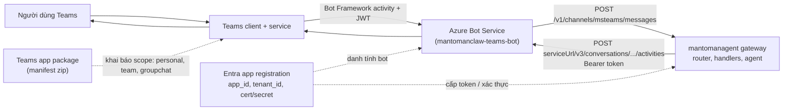
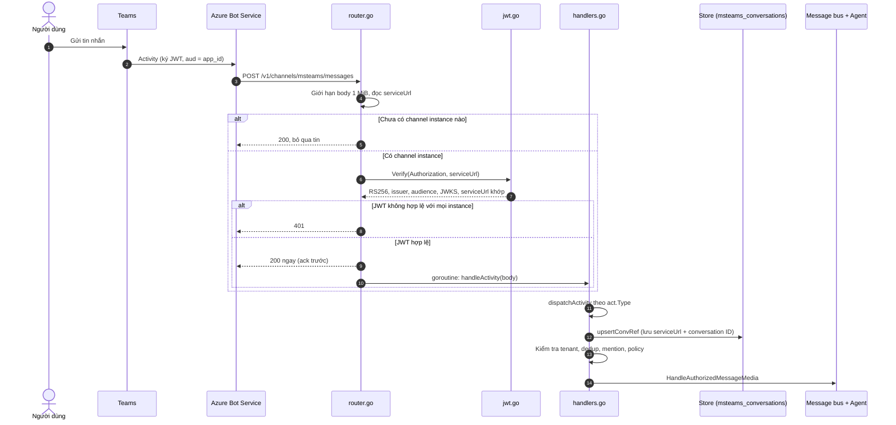
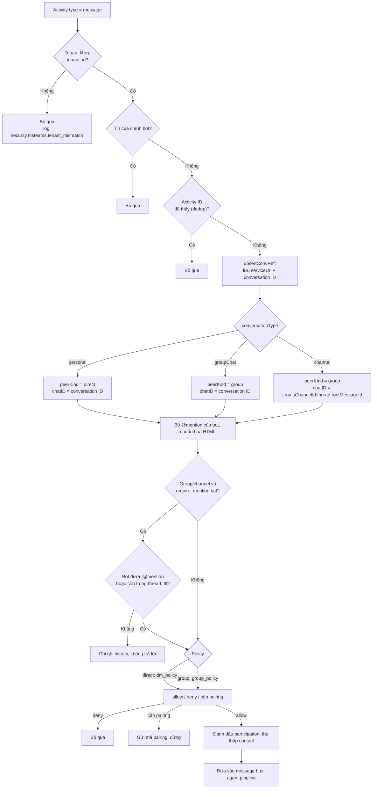
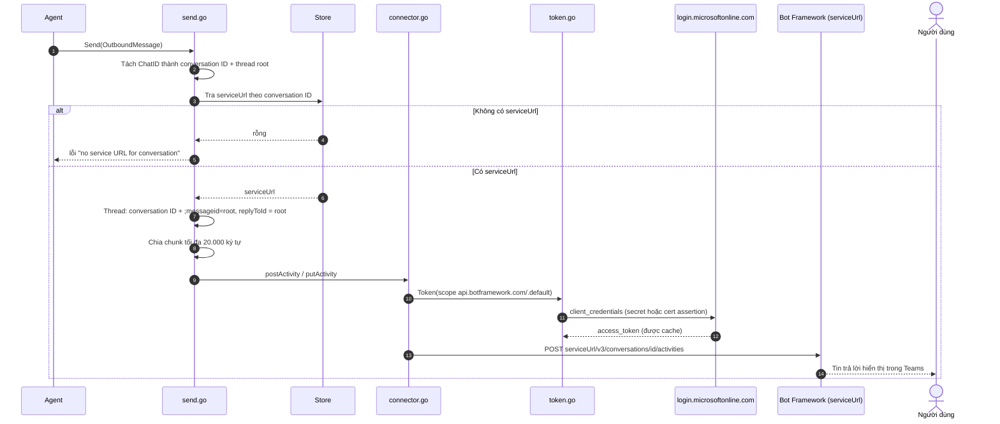
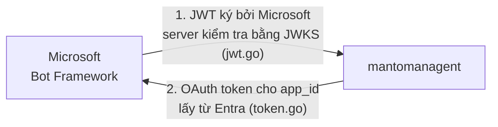

# Luồng tin nhắn kênh Microsoft Teams

Tài liệu giải thích kiến trúc và luồng xử lý tin nhắn của kênh `msteams` (`internal/channels/msteams/`), áp dụng cho chat cá nhân (DM), group chat và thread trong channel.

## 1. Kiến trúc tổng quan

Bốn thành phần phối hợp, mỗi thành phần đảm nhiệm một việc riêng.

| Thành phần | Vai trò |
|---|---|
| Teams app package (manifest) | Khai báo bot ID và các scope `personal`, `team`, `groupchat`. Chỉ khi có manifest, bot mới cài được vào DM, group chat và channel. |
| Azure Bot resource | Giữ messaging endpoint, bật Teams channel. Teams không gọi thẳng URL của bạn mà đi qua Azure Bot Service. |
| Entra app registration | Danh tính của bot: `app_id`, `tenant_id`, certificate hoặc client secret. |
| mantomanagent | Nhận request, xác thực JWT, áp dụng policy, chạy agent, gửi trả lời qua Connector API. |

Azure chỉ giữ danh tính và định tuyến. Server mantomanagent có thể chạy ở bất kỳ đâu có URL HTTPS công khai.

## 2. Luồng nhận tin (Teams đến agent)

Router trả `200` trước khi xử lý để Teams không gửi lại khi agent chạy chậm.

## 3. Xử lý trong `handleMessage`

Quy tắc theo loại hội thoại:

| Scope Teams | `conversationType` | Khóa session (`chatID`) | Policy |
|---|---|---|---|
| Chat cá nhân | `personal` | conversation ID | `dm_policy` |
| Group chat | `groupChat` | conversation ID | `group_policy` |
| Thread trong channel | `channel` | `<teamsChannelId>:thread:<rootMessageId>` | `group_policy` |

- Mỗi thread trong channel có session riêng nhờ khóa `:thread:`.
- `group_policy` mặc định là `pairing`: người dùng mới trong group phải được pairing trước khi bot trả lời.
- `require_mention` mặc định tắt. Khi bật, bot chỉ trả lời tin group/channel có @mention, và vẫn tiếp tục trả lời trong `thread_ttl` (mặc định 10 phút) sau lần trả lời gần nhất.

## 4. Luồng gửi tin (agent đến Teams)

Chi tiết:

- Chunk đầu tiên sửa (PUT) tin placeholder "Thinking..." nếu có, nếu không thì gửi mới. Các chunk còn lại và media được gửi mới.
- `connector.go` thử lại tối đa 3 lần, tôn trọng `Retry-After` khi gặp `429`, không thử lại các lỗi `4xx` khác.
- Với cert auth, token được lấy bằng client assertion RS256 có header `x5t#S256`.

## 5. Hai chiều xác thực độc lập

- **Nhận:** Microsoft chứng minh với server. Server xác minh chữ ký, issuer `https://api.botframework.com`, audience `app_id` và `serviceUrl`.
- **Gửi:** server chứng minh với Microsoft bằng token `client_credentials` của `app_id`.

## 6. Lưu ý quan trọng

- **Bot không thể nhắn trước.** `serviceUrl` và conversation ID chỉ được lưu khi có activity đến (`upsertConvRef`) hoặc bot vừa được thêm vào (`conversationUpdate`). Mỗi hội thoại cần ít nhất một tin đến trước khi gửi đi.
- **Khóa tenant.** Activity từ tenant khác `tenant_id` bị bỏ qua. Phù hợp bot nội bộ single-tenant.
- **Endpoint phải là HTTPS công khai.** Teams không gọi được localhost.
- **Mã trả `401` với request không có JWT là bình thường.** Nó chứng tỏ endpoint đang hoạt động và có ít nhất một channel instance đã đăng ký.
- **Chưa kiểm chứng trong repo:** message bus và agent pipeline thuộc framework kênh chung và không nằm trong tài liệu này. Nơi tạo placeholder "Thinking..." cũng chưa xác định, có thể là `stream.go`.
